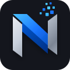

# Saksham Pandey | Personal Portfolio & Nexvora Technologies

<p align="center">
  
</p>

<h1 align="center">Saksham Pandey</h1>

<h3 align="center">
  Full Stack Engineer | Founder & CEO — Nexvora Technologies
</h3>

<p align="center">
  <strong>Engineering Dimensional, High-Performance Digital Experiences.</strong>
</p>

<p align="center">
  A professional personal portfolio, interactive 3D experience,
  technology agency website, and private content management system.
</p>

<p align="center">
  
  
  
  
  
  
</p>

---

## 1. Project Overview

This repository contains the source code for the personal portfolio of Saksham Pandey and the digital presence of Nexvora Technologies.

It combines a professional developer portfolio, a technology services showcase, an interactive 3D visual experience, a dynamic project gallery, a multi-resume repository, and a private administrative Content Management System (CMS).

The application is designed using native web technologies without frontend frameworks.

Its architecture prioritizes:

- Performance and lightweight delivery.
- Modular JavaScript architecture.
- Responsive user experiences.
- Accessible navigation and interactions.
- Interactive 3D graphics.
- Secure cloud-based content management.
- Dynamic portfolio updates.
- Reusable design tokens.
- Maintainable code organization.
- Search engine optimization.

The public website is designed to present professional experience, engineering capabilities, projects, achievements, education, resumes, and business services.

The private CMS enables authorized administrators to manage portfolio content without manually editing HTML files.

## 2. Project Identity

| Property | Details |
|---|---|
| Project | Personal Portfolio & Agency Website |
| Brand | Nexvora Technologies |
| Founder | Saksham Pandey |
| Repository | saksham-pandey-portfolio |
| Application type | Personal portfolio + technology agency |
| Frontend | HTML5, CSS3, Vanilla JavaScript |
| Backend services | Supabase |
| Database | PostgreSQL |
| Authentication | Supabase Auth |
| Storage | Supabase Storage and IndexedDB |
| Hosting | Vercel-compatible static deployment |
| Architecture | Modular, zero-build frontend |

### Brand tagline

**Empowering the Future Through Technology.**

### Business identity

Nexvora Technologies provides software development and digital technology solutions, including:

- AI Automation.
- Digital Transformation.
- Management Software.
- Website Development.
- Mobile Application Development.
- UI/UX Design.
- ERP Solutions.
- CRM Solutions.
- Custom Software Engineering.

## 3. Nexvora Technologies — Brand Identity

The following image represents the Nexvora Technologies business identity and founder's business card.

<p align="center">
  
</p>

**Brand positioning:** A technology-focused digital solutions company helping businesses build, modernize, and improve their digital presence through software engineering and technology services.

## 4. Main Objectives

The project has two connected objectives.

### Personal branding

- Present professional identity.
- Showcase technical skills.
- Display professional experience.
- Highlight education and certifications.
- Demonstrate completed projects.
- Provide role-specific resumes.
- Enable professional communication.
- Establish a credible online presence.

### Technology agency presence

- Introduce Nexvora Technologies.
- Present available IT services.
- Showcase development capabilities.
- Display selected projects and case studies.
- Allow potential clients to submit inquiries.
- Provide direct WhatsApp communication.
- Present business contact information.
- Build trust through professional presentation.

## 5. Key Features

### Public Portfolio

- Multi-page portfolio website.
- Interactive 3D hero experience.
- Animated visual components.
- Responsive navigation.
- About and agency information.
- Dynamic skills presentation.
- Professional experience timeline.
- Education section.
- Achievements and certifications.
- Project portfolio.
- Individual project case studies.
- Multiple downloadable resumes.
- Contact form.
- WhatsApp integration.
- Social media links.
- Light and dark themes.
- Responsive layouts.

### Interactive 3D Experience

The custom 3D rendering system uses HTML Canvas and JavaScript.

Features include:

- Custom 3D projection.
- Perspective transformations.
- Facet shading.
- Depth sorting.
- Pointer-based interaction.
- Orbital telemetry rings.
- Inertia-based movement.
- Interactive geometry switching.
- 3D card interactions.
- Automatic animation suspension when appropriate.

Three visual geometry modes are included:

1. Crystalline Polyhedron.
2. Distributed Hyper-Lattice.
3. Orbital Wireframe.

The rendering system is designed to minimize unnecessary work when the visual component is not visible or the browser tab is inactive.

### Skills Constellation

The skills visualization presents technical competencies using a 3D orbital network.

Features include:

- Fibonacci-sphere positioning.
- Interactive skill nodes.
- Category-based filtering.
- Skill information panel.
- Visual technology groupings.
- Animated orbital presentation.
- Compact skills matrix.

### Project Showcase

The project section provides a visual presentation of software engineering work.

Features include:

- Project cards.
- Category filtering.
- Technology stack information.
- Project summaries.
- Technical challenges.
- Personal contributions.
- Architecture information.
- Case study presentation.
- External GitHub links.
- Live project links where available.

### Multiple Resume Manager

The application includes a multi-resume system for different professional opportunities.

Resume categories include:

- Full Stack Engineer.
- Frontend Engineer.
- Distributed Systems / International.
- Backend Developer / International.

The resume section supports PDF previews, downloads, and administrator-managed resume entries.

### Contact System

The contact experience includes:

- Contact form.
- Input validation.
- Email and inquiry details.
- Subject and message fields.
- Project budget and timeline information where configured.
- WhatsApp contact URL generation.
- Professional contact links.

WhatsApp integration uses the official `wa.me` URL format.

It opens WhatsApp with a prefilled message. The visitor must review and send the message.

## 6. Private Admin CMS

One of the major components of this project is its private 20-module administrative dashboard.

Access routes:

- Admin login: `/admin/login.html`
- Admin dashboard: `/admin/index.html`

The dashboard is intended for authorized administrators.

It supports dynamic content editing, data management, resume uploads, media management, SEO settings, and website configuration.

### Complete 20-module structure

| No. | Module | Function |
|---|---|---|
| 01 | Dashboard Overview | Statistics and management overview |
| 02 | Profile & Personal Info | Name, biography, profile details |
| 03 | Hero Section | Main headline and introduction |
| 04 | About Section | About information and agency pillars |
| 05 | Skills | Technical skills management |
| 06 | Experience | Professional experience records |
| 07 | Education | Academic records |
| 08 | Projects | Project and case study management |
| 09 | Achievements | Achievements management |
| 10 | Certifications | Certification management |
| 11 | Multiple Resumes | CV and PDF management |
| 12 | Media Library | Portfolio image and media management |
| 13 | Contact & Inbox | Contact settings and inquiry inbox |
| 14 | WhatsApp Integration | Number normalization and wa.me settings |
| 15 | Theme & Design | Theme and visual configuration |
| 16 | Navigation | Navigation and section visibility |
| 17 | SEO & Open Graph | Metadata and search presentation |
| 18 | Site Settings | Website-wide settings and footer content |
| 19 | Additional CMS Settings | Supporting site configuration |
| 20 | Account & Security | Supabase connection and account management |

The module router, dashboard controller, content editor, resume manager, and settings controller are implemented as separate JavaScript modules.

### Dashboard functionality

- CMS authentication guard.
- Module-based navigation.
- Dynamic module rendering.
- Unsaved-change warnings.
- Dashboard statistics.
- Content editing.
- Confirmation before destructive actions.
- JSON backup and rollback functionality.
- Live Supabase synchronization when configured.
- Local preview support.

## 7. Technology Stack

| Technology | Purpose |
|---|---|
| HTML5 | Semantic document structure |
| CSS3 | Layout, styling and animations |
| Vanilla JavaScript | Application logic |
| ES6 Modules | Modular architecture |
| HTML Canvas | Custom 3D renderer |
| Supabase | Managed backend services |
| PostgreSQL | Relational database |
| Supabase Auth | Administrator authentication |
| PostgREST | Database REST interface |
| Supabase Storage | Resume and media files |
| IndexedDB | Local binary file storage |
| localStorage | Local application state |
| BroadcastChannel | Cross-tab synchronization |
| IntersectionObserver | Visibility-aware animations |
| Vercel | Static hosting and deployment |
| Node.js | Local testing and verification |

No React, Next.js, Vue, Angular, Svelte, Tailwind, Bootstrap, or jQuery frontend framework is required by the application.

## 8. Architecture

The project follows a modular frontend architecture with a managed cloud backend.

```text
                 WEBSITE VISITOR
                        |
                        v
              PUBLIC PORTFOLIO
                        |
       +----------------+----------------+
       |                |                |
       v                v                v
     Home             About            Projects
       |                |                |
       +----------------+----------------+
                        |
                        v
                     Contact
                        |
                        v
               APPLICATION SERVICES
                        |
              +---------+---------+
              |                   |
              v                   v
        Supabase Cloud       Local Preview
              |                   |
       +------+-------+       localStorage
       |      |       |       IndexedDB
       v      v       v
     Auth  Database  Storage
              |
              v
          PostgreSQL
              |
              v
         RLS Policies
```

### Frontend architecture

The frontend is responsible for:

- Page rendering.
- Navigation.
- Responsive interactions.
- Theme management.
- Animation lifecycle.
- 3D rendering.
- Content presentation.
- Project filtering.
- Resume viewing.
- Contact validation.
- Administrator interface.

### Cloud architecture

Supabase provides:

- PostgreSQL database.
- Authentication.
- REST database access.
- Storage buckets.
- Row-Level Security.
- Cloud persistence.

### Local preview architecture

When cloud credentials are not configured, the application can use local browser storage.

- localStorage stores structured application data.
- IndexedDB stores binary files.
- BroadcastChannel synchronizes changes between open tabs.
- Storage events support cross-tab updates.

Local Preview Mode is intended for development and demonstration, not as a substitute for secure cloud authentication.

## 9. Repository Structure

```text
personal-portfolio/
│
├── index.html
├── about.html
├── projects.html
├── contact.html
├── 404.html
│
├── README.md
├── .gitignore
├── robots.txt
├── sitemap.xml
├── vercel.json
│
├── assets/
│   ├── icons/
│   │   ├── favicon.svg
│   │   └── nexvora-logo.svg
│   │
│   ├── images/
│   │   ├── nexvora-card.jpg
│   │   ├── saksham-profile.png
│   │   ├── project-aether-ui.svg
│   │   ├── project-hyperflux-rt.svg
│   │   ├── project-nexvora-mesh.svg
│   │   └── project-synapse-ai.svg
│   │
│   └── resumes/
│       ├── Saksham_Pandey_Full_Stack_Engineer_Resume.pdf
│       ├── Saksham_Pandey_Frontend_Engineer_Resume.pdf
│       ├── Saksham_Pandey_Distributed_Systems_EU_Resume.pdf
│       └── Saksham_Pandey_Backend_Developer_RU_Resume.pdf
│
├── css/
│   ├── tokens.css
│   ├── base.css
│   ├── layout.css
│   ├── components.css
│   ├── animations.css
│   ├── responsive.css
│   └── admin.css
│
├── js/
│   ├── app.js
│   ├── navigation.js
│   ├── animations.js
│   ├── scene-3d.js
│   ├── projects.js
│   ├── skills.js
│   ├── resumes.js
│   ├── contact.js
│   ├── theme.js
│   ├── utils.js
│   ├── config.example.js
│   │
│   ├── data/
│   │   ├── seed-data.js
│   │   └── repository.js
│   │
│   └── services/
│       ├── api.js
│       ├── auth.js
│       └── storage.js
│
├── admin/
│   ├── index.html
│   ├── login.html
│   ├── css/
│   │   └── admin.css
│   └── js/
│       ├── admin.js
│       ├── dashboard.js
│       ├── content-editor.js
│       ├── resume-manager.js
│       └── settings.js
│
├── backend/
│   ├── schema.sql
│   ├── policies.sql
│   └── migrations/
│       └── 001_initial_setup.sql
│
└── tests/
    ├── README.md
    ├── build-file-protocol-bundles.mjs
    ├── dom-integration-test.mjs
    └── verify-suite.mjs
```

## 10. Frontend Module Documentation

### index.html

The main landing page.

Includes the hero experience, 3D presentation, technical skills preview, featured projects, navigation, and collaboration information.

### about.html

Presents personal and business information.

Includes professional background, Nexvora Technologies, skills, experience, education, achievements, and certifications.

### projects.html

Provides the project portfolio and resume repository.

Includes project filtering, case study presentation, resume selection, and PDF viewing.

### contact.html

Provides the professional contact experience.

Includes contact details, inquiry form, and WhatsApp integration.

### 404.html

Custom not-found page.

### css/tokens.css

Defines the reusable design system.

Includes:

- Brand colours.
- Typography variables.
- Spacing.
- Borders.
- Shadows.
- Theme variables.
- Design constants.

### css/base.css

Provides base styles, reset rules, typography, accessibility support, and print styling.

### css/layout.css

Defines page structures, grids, section spacing, and layout systems.

### css/components.css

Contains reusable buttons, cards, dialogs, panels, and UI components.

### css/animations.css

Defines entrance effects, scroll reveals, cursor interactions, and visual transitions.

### css/responsive.css

Contains responsive breakpoints and device-specific layout behavior.

## 11. JavaScript Module Documentation

### app.js

Main public application orchestrator.

Coordinates the initialization of page functionality.

### navigation.js

Handles navigation, mobile menu interactions, and scroll-related navigation behavior.

### animations.js

Controls animation sequences and visibility-based animation behavior.

### scene-3d.js

Implements the custom 3D rendering engine.

Responsibilities:

- Canvas initialization.
- 3D projection.
- Geometry generation.
- Perspective calculations.
- Facet shading.
- Depth sorting.
- Pointer interaction.
- Animation timing.
- Visibility-based suspension.

### projects.js

Handles project presentation, filtering, and case study interactions.

### skills.js

Implements the 3D skill constellation and category filtering.

### resumes.js

Handles resume listing, preview, and download behavior.

### contact.js

Handles contact form validation and WhatsApp link generation.

### theme.js

Controls light and dark themes and related visual preferences.

### utils.js

Provides shared utility functions.

Includes HTML escaping, URL sanitization, and WhatsApp helper functions.

### data/seed-data.js

Contains starter portfolio information.

This includes profile, skills, experience, education, projects, resumes, social links, settings, and related content.

### data/repository.js

Provides the unified content repository.

Responsibilities:

- Content retrieval.
- Content updates.
- Collection management.
- Local state persistence.
- Cloud synchronization.
- Snapshot management.
- Rollback checkpoints.
- Cross-tab synchronization.

### services/api.js

Implements the native Fetch-based Supabase REST client.

### services/auth.js

Manages administrator authentication and local preview authentication state.

### services/storage.js

Manages cloud file storage and local IndexedDB file operations.

## 12. Admin CMS Module Documentation

### admin.js

The main administrative controller.

It manages:

- Authentication guards.
- Module navigation.
- Active module state.
- Dynamic module rendering.
- Unsaved-change handling.
- Administrative session flow.

### dashboard.js

Provides the dashboard overview, statistics, JSON backup, and rollback history.

### content-editor.js

Provides editing functionality for profile, hero, about, and portfolio collections.

### resume-manager.js

Handles resume management and media library functionality.

### settings.js

Contains the contact, WhatsApp, theme, navigation, SEO, website settings, and security configuration interfaces.

## 13. Supabase Backend

Supabase is used as the managed backend platform.

The frontend communicates with Supabase using native JavaScript Fetch requests.

### Services

- PostgreSQL database.
- PostgREST API.
- Supabase Authentication.
- Supabase Storage.
- JWT-based sessions.
- Row-Level Security.

### Database schema

The primary database schema is located at:

`backend/schema.sql`

The schema contains the following main tables:

| Table | Purpose |
|---|---|
| portfolio_state | Portfolio state and structured payload |
| profile | Main profile information |
| site_settings | Website-wide settings |
| skills | Technical skills |
| experiences | Professional experience |
| education | Academic history |
| projects | Project records |
| project_media | Project media |
| achievements | Achievements |
| certifications | Certifications |
| resumes | Resume records |
| social_links | Social profiles |
| contact_settings | Contact and communication settings |
| contact_messages | Visitor inquiries |

The database uses PostgreSQL JSONB where structured configuration and flexible content are appropriate.

### Initial migration

`backend/migrations/001_initial_setup.sql`

Creates the initial portfolio state record.

### Row-Level Security

`backend/policies.sql`

Defines database-level access policies.

The intended access model is:

- Public visitors can read published portfolio content.
- Unpublished drafts should remain private.
- Authenticated administrators can manage portfolio records.
- Public visitors can submit contact inquiries.
- Public visitors cannot read private contact messages.
- Authorized administrators can manage stored media and resumes.

**Security requirement:** The included policies use the Supabase authenticated role for administrative permissions. For a real public deployment, restrict administrative privileges to explicitly authorized administrator accounts. An authenticated Supabase account must not automatically be treated as your administrator.

## 14. Supabase Storage

The project uses two primary storage buckets:

### resumes

Used for:

- PDF resumes.
- Updated CV files.
- Resume document hosting.

### portfolio-media

Used for:

- Profile images.
- Project images.
- Portfolio media.
- Other managed assets.

Public read access is configured for these buckets in the supplied policies.

Uploads, updates, and deletions are intended for authenticated administrators.

Review file size, MIME-type validation, filename handling, and bucket permissions before production.

## 15. Authentication and Administration

The administrator interface uses Supabase authentication when cloud mode is configured.

The login page is:

`/admin/login.html`

The dashboard is:

`/admin/index.html`

### Initial administrator setup

1. Create a Supabase project.
2. Open Authentication.
3. Create your administrator account.
4. Confirm the administrator account.
5. Disable public email signups if this is a single-administrator website.
6. Configure the frontend with the Supabase project URL and public anon key.
7. Sign in through the admin login page.

Never place the Supabase service-role key in frontend JavaScript.

The public anon key is designed for browser use when database permissions are correctly enforced with RLS.

## 16. Local Development Setup

The project does not require a frontend build process.

It uses native HTML, CSS, and ES6 JavaScript modules.

### Requirements

- Windows, macOS, or Linux.
- A modern web browser.
- Node.js (optional for local testing).
- Python 3 (optional for local hosting).
- Git.
- Supabase account for cloud mode.

### Clone the repository

```bash
git clone https://github.com/YOUR-USERNAME/saksham-pandey-portfolio.git
```

### Enter the directory

```bash
cd saksham-pandey-portfolio
```

### Option A: Python HTTP server

```bash
python -m http.server 8080
```

Open:

```text
http://localhost:8080/
```

### Option B: Node.js static server

```bash
npx serve . -l 8080
```

Open:

```text
http://localhost:8080/
```

### Important

Do not open the HTML files directly using `file://`.

ES6 modules and browser security policies require an HTTP server for reliable local development.

## 17. Supabase Configuration

The configuration template is:

`js/config.example.js`

Create your local configuration:

```text
js/config.js
```

Use the following structure:

```javascript
export default {
  supabaseUrl:
    "https://YOUR-PROJECT-REF.supabase.co",

  supabaseAnonKey:
    "YOUR-SUPABASE-ANON-KEY",

  storageBucketResumes:
    "resumes",

  storageBucketMedia:
    "portfolio-media"
};
```

Use the actual export structure from `config.example.js` when creating your configuration file.

Alternatively, configure Supabase through the Admin Dashboard's Account & Security module.

Never commit `js/config.js` if it contains local credentials or environment-specific configuration.

Never expose service-role keys or database passwords.

## 18. Database Installation

1. Create a Supabase project.
2. Open the Supabase SQL Editor.
3. Open `backend/schema.sql`.
4. Copy its contents.
5. Execute the SQL.
6. Open `backend/policies.sql`.
7. Execute the RLS policy definitions.
8. Open `backend/migrations/001_initial_setup.sql`.
9. Execute the initial migration.
10. Verify that the tables and storage buckets exist.

Run the SQL files in the documented order.

Back up existing production data before applying schema or policy changes.

## 19. Contact and WhatsApp Integration

The application provides a WhatsApp contact experience using official WhatsApp deep links.

The administrator can configure:

- WhatsApp phone number.
- Country code.
- Default greeting.
- Floating button visibility.
- Floating button label.

### Number validation

The application normalizes phone numbers into digits-only international format.

The intended validation length is 8–15 digits.

### Example

```text
https://wa.me/919999999999
```

### Prefilled messages

The application generates encoded message content using URL encoding.

Visitors open WhatsApp and review the prefilled message before sending it.

This is not automatic background message delivery.

For automated business messaging, a separate server-side Meta WhatsApp Business Platform integration would be required.

## 20. Resume Management

The portfolio includes multiple role-specific resume documents.

The administrator can manage resume records through the CMS.

Typical management operations include:

- Adding a resume.
- Updating resume metadata.
- Uploading a PDF.
- Replacing a resume.
- Removing an outdated resume.
- Managing resume visibility.
- Displaying a resume preview.
- Providing a download link.

The current repository contains starter resume PDFs.

Review every PDF before public deployment and replace any document that is not intended for publication.

## 21. SEO and Social Sharing

The application includes:

- Page titles.
- Meta descriptions.
- Open Graph settings.
- Canonical URL settings.
- Social preview image settings.
- `robots.txt`.
- `sitemap.xml`.
- Responsive page metadata.

The administrator SEO module supports configurable website metadata.

Verify that the canonical URL and Open Graph image use the final production domain.

Check that private admin pages are not unintentionally indexed.

## 22. Responsive Design

The website is intended to support:

- Desktop computers.
- Laptops.
- Tablets.
- Mobile phones.

The responsive stylesheet is:

`css/responsive.css`

The design system uses reusable tokens, layout rules, and component styles.

Test navigation, project cards, contact forms, resume previews, and the admin dashboard at different viewport sizes.

## 23. Accessibility

The project includes accessibility-oriented implementation practices.

These include:

- Semantic HTML.
- ARIA labels.
- Live regions.
- Keyboard interaction support.
- Dialog focus management.
- Visible focus styles.
- Reduced-motion support.
- Print stylesheet support.

Accessibility should be tested with keyboard navigation and screen readers before release.

## 24. Security

Security is an important consideration because the application includes a private CMS and visitor contact submissions.

### Frontend security

- Escape user-generated HTML.
- Sanitize externally supplied URLs.
- Avoid inserting untrusted content as executable HTML.
- Validate contact form fields.
- Validate uploaded files.
- Keep administrator credentials private.
- Avoid storing privileged keys in browser code.

### Database security

- Enable RLS.
- Separate public reads from administrator writes.
- Restrict unpublished content.
- Protect contact messages.
- Verify ownership and authorization.
- Use least-privilege access policies.

### Authentication security

- Disable public registration when unnecessary.
- Use strong administrator credentials.
- Protect administrator sessions.
- Avoid exposing access tokens.
- Review session expiry and logout behavior.

### File security

- Validate file extensions.
- Validate MIME types.
- Enforce upload size limits.
- Avoid executable uploads.
- Use controlled storage buckets.
- Review public access to uploaded files.

### Important production warning

The provided SQL policies are the project's starting access-control configuration. Review and strengthen them before exposing the CMS to the public internet.

## 25. Performance Optimization

The application uses several browser-native techniques to improve performance.

### 3D rendering

- Canvas rendering.
- Animation frame scheduling.
- Visibility-based suspension.
- IntersectionObserver.
- Page visibility handling.
- Reduced unnecessary background rendering.

### Frontend delivery

- No frontend framework runtime.
- No required bundler.
- Modular JavaScript.
- Reusable CSS.
- Browser-native APIs.
- Static asset delivery.

### Deployment caching

The Vercel configuration includes long-lived caching for assets under `/assets/`.

Only use immutable caching when asset filenames change when their contents change.

## 26. Cross-Tab Synchronization

The repository layer uses browser-native synchronization APIs.

### BroadcastChannel

Allows application tabs to communicate when portfolio content changes.

### Storage events

Provides a fallback synchronization mechanism for supported local storage updates.

This makes the local administrative preview more convenient when multiple portfolio tabs are open.

## 27. Local Preview Mode

Local Preview Mode enables development without an immediately configured Supabase backend.

It uses:

- localStorage for structured state.
- IndexedDB for binary files.
- Browser storage events.
- BroadcastChannel.
- Local authentication simulation.

This mode is useful for:

- Interface development.
- CMS demonstrations.
- Testing content editing.
- Previewing design changes.
- Working before cloud configuration.

It must not be treated as secure production authentication.

Local browser storage can be modified by the user and does not provide server-side access control.

## 28. Automated Testing

The project includes a Node.js verification suite.

Run:

```bash
node tests/verify-suite.mjs
```

Additional tests:

```bash
node tests/build-file-protocol-bundles.mjs
```

```bash
node tests/dom-integration-test.mjs
```

Review the individual test documentation:

`tests/README.md`

### Main verification areas

- Frontend framework restrictions.
- HTML escaping.
- URL sanitization.
- File validation.
- WhatsApp URL generation.
- Public and unpublished content separation.
- File integrity.
- Application structure.

A passing local verification suite does not replace production security testing or real browser testing.

## 29. Deployment on Vercel

The repository includes:

`vercel.json`

The application is designed for static hosting.

### Deployment steps

1. Push the repository to GitHub.
2. Log in to Vercel.
3. Select Add New Project.
4. Import the GitHub repository.
5. Select the project root directory.
6. Configure static deployment.
7. No framework build command is required.
8. Set the output directory to the project root if requested.
9. Deploy the project.
10. Configure Supabase using the production project credentials.
11. Test the public website.
12. Test administrator authentication.
13. Verify media and resume uploads.
14. Verify contact and WhatsApp links.
15. Configure a custom domain if required.

### Deployment configuration

The included Vercel configuration defines:

- Security-related HTTP headers.
- Asset cache-control behavior.
- URL handling preferences.

Review hosting configuration whenever deployment architecture changes.

## 30. Environment and Configuration Files

| File | Purpose |
|---|---|
| `js/config.example.js` | Supabase configuration template |
| `backend/schema.sql` | Database schema |
| `backend/policies.sql` | RLS policies |
| `backend/migrations/001_initial_setup.sql` | Initial data migration |
| `vercel.json` | Hosting configuration |
| `.gitignore` | Git exclusion rules |

## 31. Known Limitations and Production Considerations

Before treating this project as a fully production-ready CMS, review the following:

- Local Preview Mode is not a secure cloud authentication system.
- Supabase RLS policies need an explicit administrator authorization model.
- Contact form delivery depends on the configured application flow; a mail-delivery provider is not automatically implied.
- WhatsApp `wa.me` links require visitor interaction.
- Public storage buckets expose their files to public readers.
- Large uploaded files require appropriate size limits.
- Local storage is browser-specific.
- IndexedDB content is not automatically synchronized across devices.
- Browser storage may be cleared by users.
- Production database backups and recovery procedures must be configured.
- Supabase configuration should be validated before launch.
- Administrator access must be tested with unauthorized accounts.
- SEO metadata should be checked on deployed pages.
- 3D animation performance should be measured on mobile devices.

## 32. Recommended Production Checklist

### Branding

- [ ] Verify Nexvora logo.
- [ ] Verify business card image.
- [ ] Verify founder profile image.
- [ ] Verify all public contact information.
- [ ] Verify business service descriptions.
- [ ] Verify social media links.

### Portfolio content

- [ ] Verify profile information.
- [ ] Verify hero section.
- [ ] Verify skills.
- [ ] Verify experience.
- [ ] Verify education.
- [ ] Verify projects.
- [ ] Verify achievements.
- [ ] Verify certifications.
- [ ] Verify resumes.
- [ ] Remove sample placeholders.

### CMS

- [ ] Verify all 20 modules.
- [ ] Test administrator login.
- [ ] Test logout.
- [ ] Test content creation.
- [ ] Test content editing.
- [ ] Test content deletion.
- [ ] Test publishing and draft visibility.
- [ ] Test rollback functionality.
- [ ] Test cloud synchronization.

### Database and security

- [ ] Run the database schema.
- [ ] Apply RLS policies.
- [ ] Restrict administrator privileges.
- [ ] Disable unnecessary public signups.
- [ ] Verify contact-message privacy.
- [ ] Verify storage policies.
- [ ] Verify file validation.
- [ ] Review browser-exposed configuration.
- [ ] Confirm no privileged secrets are committed.

### Website

- [ ] Test desktop layout.
- [ ] Test mobile layout.
- [ ] Test navigation.
- [ ] Test 3D interactions.
- [ ] Test reduced-motion behavior.
- [ ] Test contact form.
- [ ] Test WhatsApp links.
- [ ] Test resume previews.
- [ ] Test downloads.
- [ ] Test SEO metadata.

### Deployment

- [ ] Run automated tests.
- [ ] Verify GitHub repository.
- [ ] Configure Vercel.
- [ ] Configure Supabase production connection.
- [ ] Verify custom domain.
- [ ] Verify HTTPS.
- [ ] Verify security headers.
- [ ] Verify backup strategy.
- [ ] Test the live website.

## 33. Git and GitHub Workflow

### Clone

```bash
git clone https://github.com/YOUR-USERNAME/saksham-pandey-portfolio.git
```

### Enter repository

```bash
cd saksham-pandey-portfolio
```

### Check status

```bash
git status
```

### Stage changes

```bash
git add .
```

### Review staged changes

```bash
git diff --cached
```

### Commit changes

```bash
git commit -m "Update personal portfolio and CMS"
```

### Push changes

```bash
git push
```

### Pull remote changes

```bash
git pull --rebase origin main
```

### Create a feature branch

```bash
git switch -c feature/portfolio-improvements
```

### Push a feature branch

```bash
git push -u origin feature/portfolio-improvements
```

### Check configured remote

```bash
git remote -v
```

## 34. Future Improvements

Potential future development areas include:

- Advanced portfolio analytics.
- Enhanced CMS audit history.
- Additional administrator roles.
- Improved media optimization.
- Rich project case studies.
- Advanced SEO controls.
- Better content revision history.
- Automated contact notifications.
- More detailed performance monitoring.
- Enhanced accessibility testing.
- Additional visual themes.
- Improved automated browser testing.
- Internationalization.
- More granular content permissions.

These are potential improvements and should not be interpreted as already implemented features.

## 35. Contribution Guidelines

Contributions should maintain the project's existing architecture and coding standards.

Guidelines:

1. Keep JavaScript modular.
2. Avoid unnecessary dependencies.
3. Preserve responsive behavior.
4. Follow the existing design token system.
5. Maintain accessibility.
6. Sanitize untrusted input.
7. Respect database security policies.
8. Update documentation when functionality changes.
9. Test changes before submitting.
10. Avoid committing secrets or personal user data.

## 36. License

No explicit open-source license was identified in the supplied project.

Unless a license is added, all rights remain with the copyright holder under applicable copyright law.

Add an appropriate license file before permitting public reuse, modification, or redistribution.

## 37. Acknowledgements

Built and maintained by Saksham Pandey.

**Nexvora Technologies**

Empowering the Future Through Technology.

---

<p align="center">
  <strong>Designed with engineering precision. Built for digital growth.</strong>
</p>

<p align="center">
  © Saksham Pandey | Nexvora Technologies
</p>
